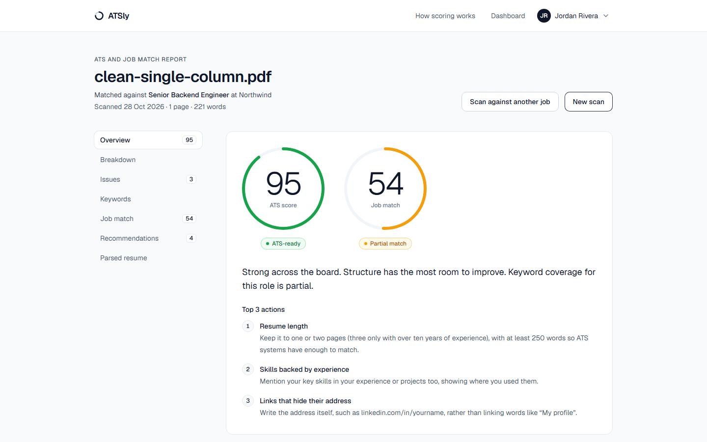
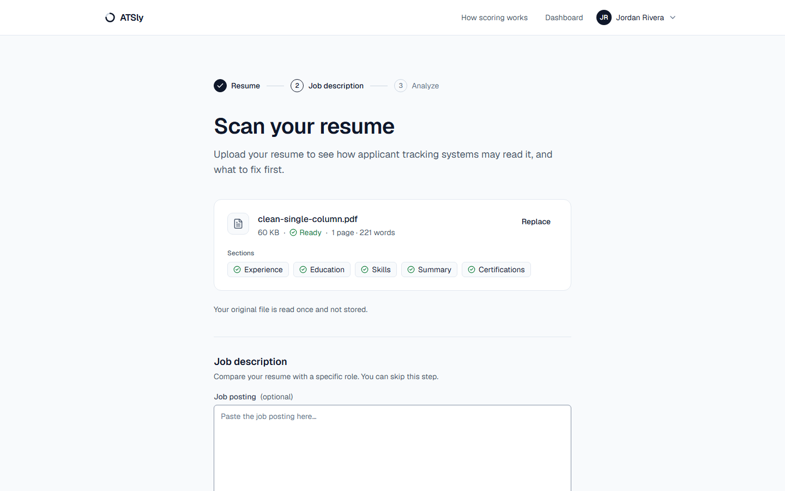
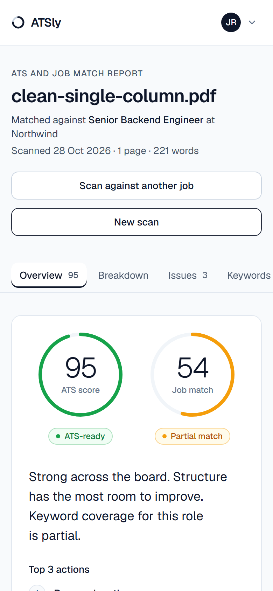
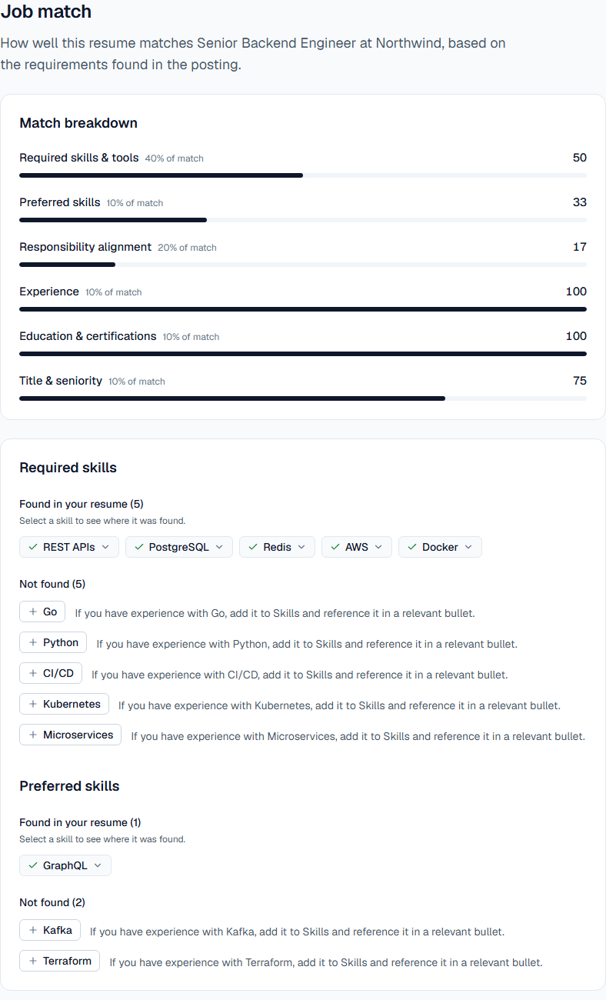
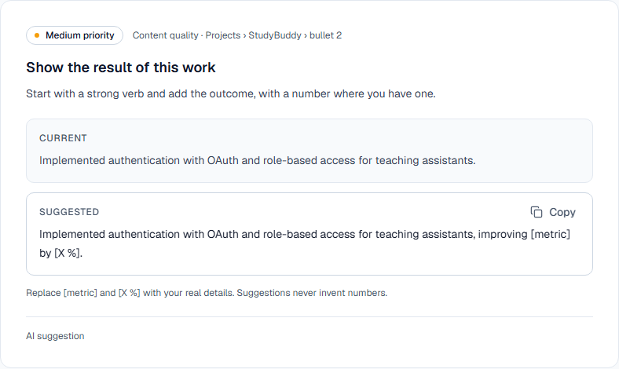
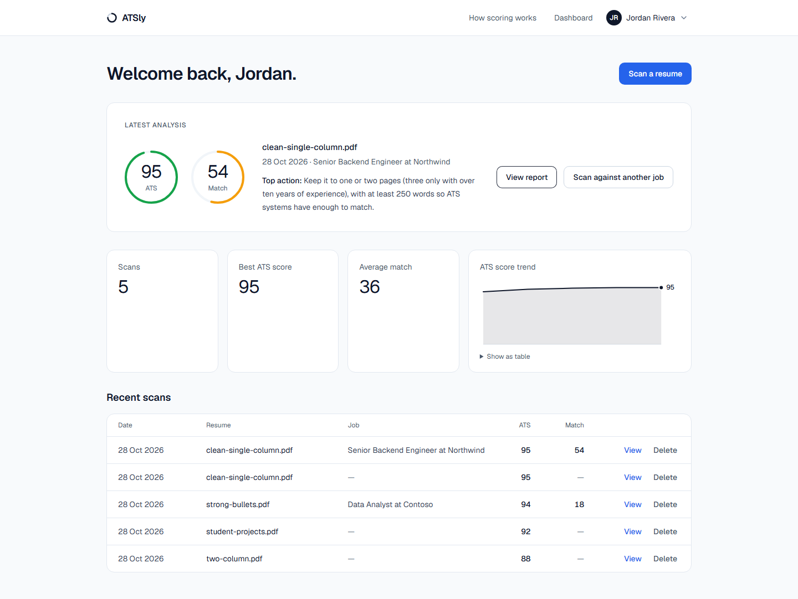
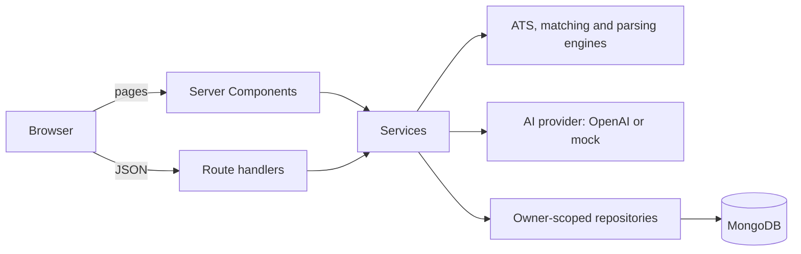

# ATSly

**An explainable ATS resume scanner and job matcher.** Upload a resume and see how
applicant tracking systems may read it, how well it matches a role, and exactly what to
change, with every claim traced back to your own text.

[](https://github.com/Nevindisadeera/ATSly/actions/workflows/ci.yml)
[](LICENSE)




## What ATSly does

- **ATS compatibility score (0–100).** 55 rule-based checks in six weighted categories:
  formatting, structure, completeness, keywords, content quality and readability. Every
  deduction says what was found, where, and how to fix it.
- **Job match score.** Paste a job description to see which required and preferred skills
  your resume shows, which are missing, and how your experience, education and title fit.
- **Specific recommendations.** Prioritized changes, with before-and-after rewrites of your
  own bullets that keep your facts and leave placeholders like `[X %]` instead of inventing
  numbers.

**Honest by design.** The deterministic engine owns the score: AI can move it by at most
3 points, and anything AI quotes from your resume is checked against your resume before it
is shown. ATSly never tells you to add a skill you don't have; it says "if you have
experience with X, make it explicit". The score is an estimate based on common ATS parsing
practices, not a promise about any specific vendor.

## Feature tour

<table>
  <tr>
    <td width="58%"></td>
    <td><strong>Upload.</strong> PDF or DOCX up to 4 MB. The parser shows the sections it found before you analyze, and the original file is never stored.</td>
  </tr>
  <tr>
    <td><strong>Report.</strong> Score hero, category breakdown, issues grouped by category with the evidence and the fix, keywords, and the resume as an ATS reads it, on any screen size.</td>
    <td align="center"></td>
  </tr>
  <tr>
    <td></td>
    <td><strong>Job match.</strong> Six weighted components, matched skills with the quote that proves them, and conditional suggestions for what's missing.</td>
  </tr>
  <tr>
    <td><strong>Recommendations.</strong> Prioritized and filterable. Rewrites keep your facts, leave placeholders for numbers, and copy in one click.</td>
    <td></td>
  </tr>
</table>



Guests can scan without an account; their reports are deleted after 7 days. Signing up
keeps them, adds a dashboard with score history, and lets you delete everything at any time.

## How scoring works

| Category          | Weight | What it checks                                                                                                           |
| ----------------- | -----: | ------------------------------------------------------------------------------------------------------------------------ |
| Formatting        |     25 | Tables, text boxes, columns, scanned pages, images, contact details in headers, unreadable characters, fonts and symbols |
| Structure         |     20 | Standard headings, dated roles in reverse order, titles and companies, length, repeated sections                         |
| Completeness      |     15 | Name, email, phone, location, links, summary, experience, education, skills                                              |
| Keywords & skills |     15 | A skills section, recognized hard skills, skills backed by experience, acronyms, stuffing, buzzwords                     |
| Content quality   |     15 | Action verbs, quantified results, bullet length, weak phrases, AI-rated impact (at most 3 points overall)                |
| Readability       |     10 | Bullet length, paragraph blocks, density, passive voice, reading level, consistency                                      |

Each check deducts points within its category, scaled by how certain the detection is.
The full check catalogue is in [`docs/SCORING.md`](docs/SCORING.md), generated from the
code, and in plain language on the app's `/methodology` page.
Job matching is described in [`docs/MATCHING.md`](docs/MATCHING.md).

## Architecture



Pages and API routes call one service layer; engines are pure functions; every database
query is scoped by owner (a signed-in user or a signed guest cookie). Scans run after the
response with `after()`, and the browser polls their status. Details, including the scan
pipeline and the AI guardrails, are in [`docs/ARCHITECTURE.md`](docs/ARCHITECTURE.md).

**Stack:** Next.js 16 (App Router, Turbopack) · React 19 · TypeScript (strict) ·
Tailwind CSS v4 · shadcn/ui on Radix · Zod 4 · MongoDB with Mongoose 9 · Auth.js v5 ·
OpenAI Responses API · pdf.js · Vitest · Playwright with axe-core

## Getting started

**Prerequisites:** Node.js 22 or later. MongoDB is optional: `npm run db:local` runs one
for you. An OpenAI key is optional: without one, a deterministic offline AI provider is
used, so everything works locally.

```bash
git clone https://github.com/Nevindisadeera/ATSly.git
cd ATSly
npm install
cp .env.example .env.local    # then set AUTH_SECRET (the file shows how to generate it)
npm run db:local              # terminal 1: local MongoDB, data in .data/mongo
npm run dev                   # terminal 2: http://localhost:3000
```

### Environment

All variables are documented in [`.env.example`](.env.example).

| Variable                                | Required   | Default                             | Purpose                                                     |
| --------------------------------------- | ---------- | ----------------------------------- | ----------------------------------------------------------- |
| `AUTH_SECRET`                           | yes        | —                                   | Signs sessions and the guest cookie; at least 32 characters |
| `MONGODB_URI`                           | yes        | `mongodb://127.0.0.1:27017/atsly`   | Local MongoDB or an Atlas `mongodb+srv://` URI              |
| `NEXT_PUBLIC_APP_URL`                   | no         | `http://localhost:3000`             | Absolute URLs                                               |
| `AI_PROVIDER`                           | no         | `mock` without a key, else `openai` | `openai`, `mock` or `off`                                   |
| `OPENAI_API_KEY`                        | for OpenAI | —                                   | AI analysis                                                 |
| `OPENAI_MODEL`                          | no         | `gpt-4.1-mini`                      | Choose with `npm run eval:ai`                               |
| `AI_TIMEOUT_MS` / `AI_DAILY_BUDGET_USD` | no         | `25000` / `5`                       | Per-call timeout and global daily spend cap                 |
| `AUTH_GOOGLE_ID` / `AUTH_GOOGLE_SECRET` | no         | —                                   | Google sign-in, shown when both are set                     |
| `GUEST_RETENTION_DAYS`                  | no         | `7`                                 | When guest data is deleted                                  |
| `RATE_LIMIT_*`                          | no         | see file                            | Uploads and scans per guest, user and network               |

### Scripts

| Script                            | Purpose                                                                      |
| --------------------------------- | ---------------------------------------------------------------------------- |
| `npm run dev`                     | Development server                                                           |
| `npm run db:local`                | Local MongoDB (mongodb-memory-server), no install needed                     |
| `npm run build` / `npm run start` | Production build and server                                                  |
| `npm run typecheck`               | Route types and the TypeScript compiler                                      |
| `npm run lint`                    | ESLint, including layer-boundary rules                                       |
| `npm run format` / `format:check` | Prettier                                                                     |
| `npm run test`                    | Unit and integration tests (Vitest, in-memory MongoDB)                       |
| `npm run test:coverage`           | The same, with coverage thresholds                                           |
| `npm run test:e2e`                | Playwright on desktop and mobile; run `npx playwright install chromium` once |
| `npm run eval:ai`                 | AI evals: schema validity, evidence verification, recall                     |
| `npm run docs:scoring`            | Regenerate `docs/SCORING.md` from the check registry                         |

## Project structure

```text
src/
├─ app/                 routes: (marketing), (auth), (app) pages and api/ route handlers
├─ components/          ui/ primitives, data-display/, report/, scan/, dashboard/, auth/
├─ hooks/               upload and scan-status hooks
├─ lib/
│  ├─ parsing/          PDF and DOCX extraction, section and entry parsing
│  ├─ ats/              the 55 checks, scoring, bands, headline
│  ├─ matching/         job requirement extraction, matching tiers, fit, aggregation
│  ├─ ai/               providers, prompts, schemas, evidence verification
│  ├─ services/         scan pipeline, scans, jobs, accounts, dashboard
│  ├─ db/               Mongoose models and owner-scoped repositories
│  ├─ auth/             Auth.js, guest identity, owner resolution
│  ├─ security/         rate limits, proxy rules, file signatures
│  └─ report/           view models for the results page
├─ proxy.ts             CSRF origin checks and account-page redirects
tests/                  unit/, integration/, e2e/, evals/, fixtures/
docs/                   planning, architecture, scoring, matching, API, design, testing
```

## Testing and quality

- **653 unit and integration tests** cover the engines, services and API routes against a
  real (in-memory) MongoDB. `src/lib` has 96.7 % line coverage, and the ATS and matching
  engines are held to 95 %.
- **88 Playwright tests**, each on desktop and mobile, cover every user flow, with axe-core
  accessibility checks on every page and layout checks at 320px.
- **AI evals** check schema validity, evidence verification and recall.
- **CI** runs typecheck, lint, format, coverage, the build, the E2E suite against a
  production build, and Lighthouse (accessibility, best practices and SEO are enforced).

See [`docs/TESTING.md`](docs/TESTING.md).

## Deployment

ATSly runs on Vercel with MongoDB Atlas. [`docs/DEPLOYMENT.md`](docs/DEPLOYMENT.md) covers
the Atlas and Vercel setup, every production variable, Google sign-in, security headers,
monitoring, and the launch checklist.

## Roadmap

- **V1.1:** password reset, email verification, PDF export, share by link, download my data.
- **V2:** AI resume rewriting, resume versions and before/after comparison, application
  tracking, embeddings-based semantic matching, a richer skills taxonomy.
- **V3:** resume builder and templates, LinkedIn optimization, cover letters, premium plans,
  recruiter tools.

## Development workflow

ATSly was built in small phases from the plan in [`docs/PLANNING.md`](docs/PLANNING.md)
(§28): one branch per phase (`stage/NN-name-frontend|backend`), frontend and backend
separately, merged by pull request. Commits follow
[Conventional Commits](https://www.conventionalcommits.org) with an area scope, for
example `feat(matching): …`. See [`CONTRIBUTING.md`](CONTRIBUTING.md).

## Security and privacy

- Original files are never stored; only the extracted text and parse results are kept.
- Guest data is deleted automatically after 7 days. Account holders can delete any report,
  all their data, or their account from Settings.
- AI requests send the resume without your name, email or phone number, and ask the
  provider not to store them (`store: false`).
- Passwords are hashed with bcrypt; sessions are signed JWTs in HttpOnly cookies; every
  query is scoped to its owner; cross-site API writes are refused.
- Strict security headers on every response, and a per-request nonce Content Security
  Policy on every page that shows personal data.

Please report vulnerabilities privately as described in [`SECURITY.md`](SECURITY.md).

## Contributing and license

Contributions are welcome. Read [`CONTRIBUTING.md`](CONTRIBUTING.md) first.
Released under the [MIT License](LICENSE).
