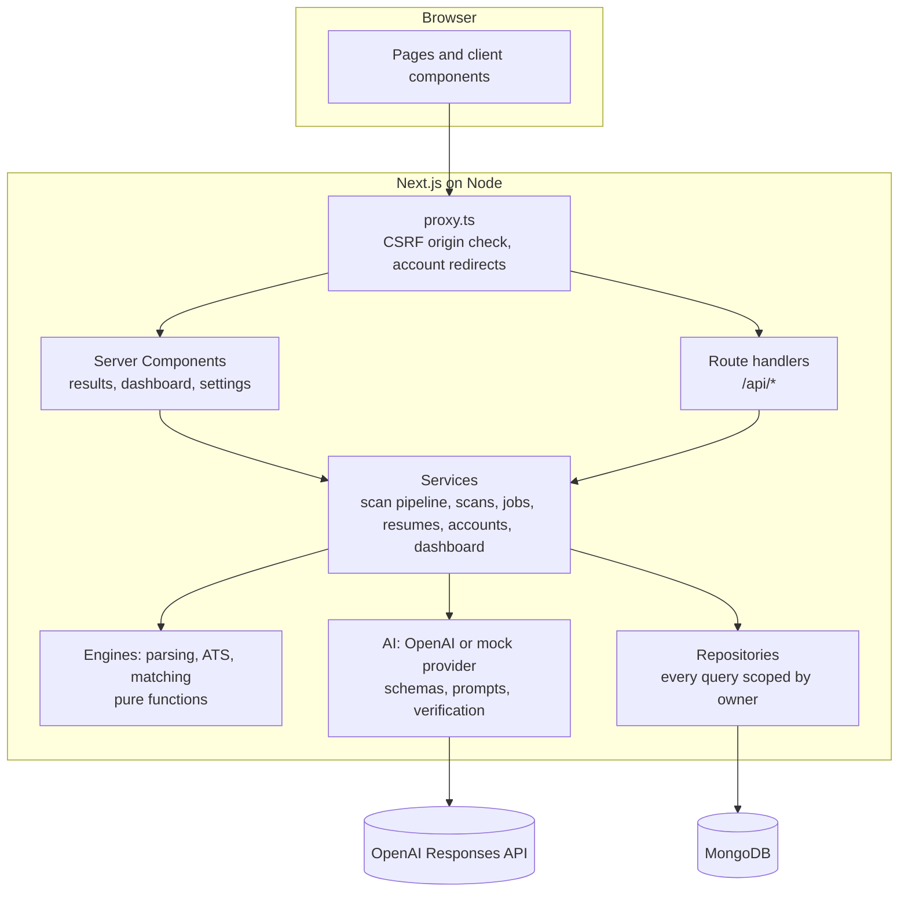
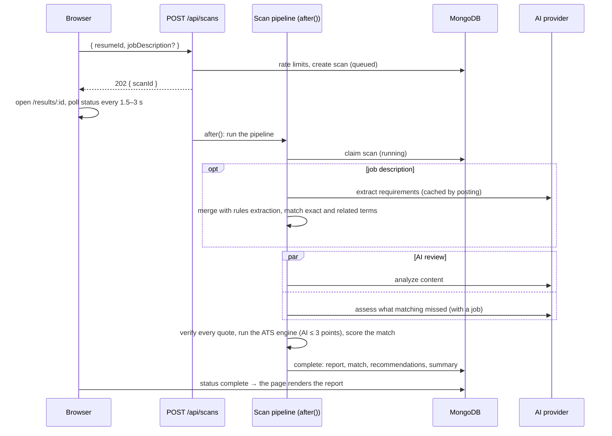

# Architecture

How ATSly is put together: the layers, how a scan flows through them, and the rules that
keep data owned, the score deterministic and AI honest. The original design and its
reasoning are in [PLANNING.md](PLANNING.md) §14–§23; this page describes the system as built.

## Layers



The rules between layers are enforced by ESLint (`eslint.config.mjs`):

- **UI code** (`src/components`, `src/hooks`) never imports the database or AI layers. It
  renders view models that the server computed.
- **Engines** (`src/lib/parsing`, `ats`, `matching`, `taxonomy`) are pure: no database, AI,
  services or Next.js imports. The same input always gives the same report, which is what
  makes scores reproducible and testable.
- **Services** are the only place that combines engines, AI and storage. Route handlers
  validate input with Zod, call one service function, and map typed `AppError`s to HTTP.
  Pages read through the same services, never over HTTP.

## A scan, end to end



- **Upload** (`POST /api/resumes`) checks size, type and magic bytes, extracts text with
  pdf.js or a DOCX reader, parses sections and entries, and stores the parsed resume. The
  original file is never stored.
- **Scans** return `202` at once and run in `after()` within the route's 60-second budget.
  The browser polls `GET /api/scans/:id/status`. A scan with no progress for 90 seconds is
  marked `TIMEOUT` the next time it is read, so a stopped function can't leave it spinning.
- **AI never blocks a report.** If AI is off, over the daily budget or failing, the scan
  completes with the deterministic report and `ai.status` says what happened
  (`complete`, `partial`, `skipped` or `failed`). The UI explains each case.

## Ownership and identity

Every resume, job description and scan carries an `owner`: `{ type: "user" | "guest", id }`.
Repository methods take the owner and add it to every query, so another person's id is
indistinguishable from one that doesn't exist; both return 404.

- **Guests** get a random id in an HttpOnly cookie signed with `AUTH_SECRET`
  (`atsly_gid`), issued on the first upload. Their data expires after 7 days through
  MongoDB TTL indexes.
- **Accounts** use Auth.js v5 with JWT sessions and no adapter: email and password
  (bcrypt, cost 12), and Google when configured. Signing in moves the browser's guest data
  to the account and stops it expiring; running that twice moves nothing.
- `resolveOwner` (routes) and `currentOwner` (Server Components) read the session first,
  then the guest cookie, the same way everywhere.
- **Deletion** cascades in a fixed order: scans, then job descriptions, then resumes, then
  the account.

## Request safety

| Concern         | Where                                                       | What                                                                                                                                                                     |
| --------------- | ----------------------------------------------------------- | ------------------------------------------------------------------------------------------------------------------------------------------------------------------------ |
| CSRF            | `src/proxy.ts`, `lib/security/proxy-rules.ts`               | Cross-site `POST/PUT/PATCH/DELETE` to `/api/*` get 403 (Auth.js checks its own token)                                                                                    |
| Account pages   | `src/proxy.ts`                                              | Signed-out visitors to `/dashboard` and `/settings` go to `/login?next=`; `next` must be a path on this site                                                             |
| Rate limits     | `lib/security`                                              | Fixed windows in MongoDB, shared by every instance: uploads per network, scans per guest, user and network, sign-ups per network, sign-in attempts per email and network |
| Files           | `lib/security/file-signature.ts`, `lib/parsing`             | Extension, MIME and magic-byte checks, 4 MB and 10 pages, ZIP bomb limits, encrypted PDFs refused                                                                        |
| Input           | `lib/validation`                                            | Zod schemas on every body and query; unknown fields rejected                                                                                                             |
| Headers and CSP | `next.config.ts`, `src/proxy.ts`, `lib/security/headers.ts` | HSTS, nosniff, frame denial and a base CSP on every response; a per-request nonce CSP on dynamic pages, in production                                                    |
| Errors          | `src/instrumentation.ts`                                    | Server errors logged with their digest; missing production configuration logged at start-up                                                                              |
| Logs            | `lib/logging`                                               | One JSON line per event with ids, codes and counts, never resume or job text                                                                                             |

## AI guardrails

AI is used for three tasks, each with a Zod schema enforced as a strict JSON schema:
extracting job requirements, analyzing content quality, and assessing what keyword
matching missed.

1. **Untrusted input.** Resume and posting text are sent as data, framed as untrusted, with
   the name, email and phone removed. Requests ask the provider not to store them.
2. **Verified evidence.** Every quote the model makes must be found in the resume (90 %
   token containment after normalization) or it is dropped. Rewrites that introduce numbers
   or proper nouns not in the resume are dropped; placeholders like `[X %]` are allowed.
3. **Bounded influence.** AI can move the ATS score by at most 3 points (check Q07). In job
   matching, a requirement AI finds counts fully only with high confidence and a verified
   quote, and half when partial. Certifications only match by name.
4. **Cost and time.** Results are cached for 30 days by task, prompt version, model and
   input hash. A global daily budget switches AI off when reached, and the AI stage has a
   40-second deadline.

The deterministic mock provider is the default without an API key, so development, tests
and CI never call a real model. `npm run eval:ai` measures schema validity, evidence
verification and recall for whichever provider is configured.

## Data model

| Collection         | Holds                                                           | Notes                                                               |
| ------------------ | --------------------------------------------------------------- | ------------------------------------------------------------------- |
| `users`            | Email, name, password hash or Google link                       | Unique email                                                        |
| `resumes`          | File metadata, extracted text and layout signals, parsed resume | Guest TTL                                                           |
| `job_descriptions` | Posting text, extracted requirements                            | Deduplicated by hash per owner; guest TTL                           |
| `scans`            | Status, ATS report, match report, AI record, summary            | The full report is embedded; lists read only the summary; guest TTL |
| `ai_cache`         | Raw model output per task                                       | Verified again every time it's used; 30-day TTL                     |
| `rate_limits`      | Window counters, including the daily AI spend                   | TTL after the window                                                |

Each scan records the engine, matching and prompt versions it was produced with, so old
reports keep their scores when the rules change.

## Folders

```text
src/app            routes: (marketing), (auth), (app) pages, api/ handlers, error pages
src/components     ui/ primitives, data-display/, report/, scan/, dashboard/, auth/, settings/
src/lib/parsing    PDF and DOCX extraction, sections and entries
src/lib/ats        checks, scoring, bands, headline
src/lib/matching   requirement extraction, matching tiers, fit, aggregation
src/lib/ai         providers, prompts, schemas, verification, recommendations
src/lib/services   the application's use cases
src/lib/db         models and repositories
src/lib/auth       Auth.js, guest identity, owner resolution
src/lib/report     results-page view models
```
