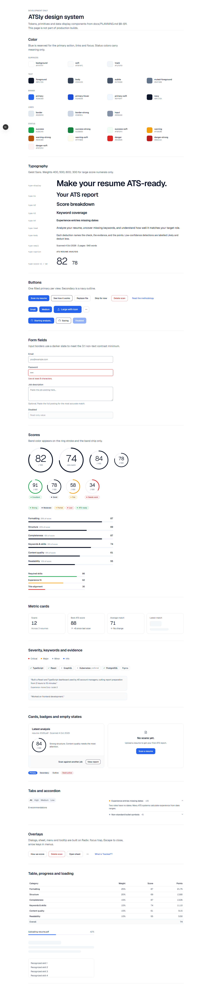

# Design

The visual and interaction system behind ATSly: calm, precise and quiet, so a resume report
reads like a well-set document rather than a dashboard of gauges. Tokens live in
[`src/app/globals.css`](../src/app/globals.css); every component and state can be seen on
the development-only page `/design` (`npm run dev`). The full rationale is in
[PLANNING.md](PLANNING.md) §8–§13.

## Principles

1. **Whitespace first.** Hierarchy comes from the size, weight and color of text, not from
   boxes. Hairline borders over shadows; no container over a container.
2. **One accent.** Blue marks the primary action, focus, links and active navigation, and
   never fills large areas.
3. **Status colors mean something.** Green, amber and red appear only for pass, warn and fail
   and for score bands, always with text, never as decoration.
4. **Brief, purposeful motion.** 150–250 ms; the score ring draws once; everything respects
   `prefers-reduced-motion`.
5. **Calm copy.** Sentence case, verbs on buttons, no exclamation marks or emoji. "We
   couldn't read this file", not "Oops!".

**Not used:** gradients, glassmorphism, glowing borders, animated backgrounds, emoji, "AI"
badges, mascots, a second accent hue, cards inside cards.

## Color

| Token                                 | Value                             | Use                                                                         |
| ------------------------------------- | --------------------------------- | --------------------------------------------------------------------------- |
| `--background` / `--soft` / `--track` | `#ffffff` / `#f8fafc` / `#f1f5f9` | Surfaces, page background, bar tracks                                       |
| `--foreground`                        | `#0f172a`                         | Headings (17.9:1 on white)                                                  |
| `--body`                              | `#334155`                         | Body copy (10.3:1)                                                          |
| `--subtle`                            | `#475569`                         | Secondary copy, also on `--soft` (7.6:1)                                    |
| `--muted-foreground`                  | `#64748b`                         | Captions on white only (4.8:1)                                              |
| `--navy`                              | `#0f172a`                         | Score rings, the chart line, the selected filter, the avatar                |
| `--primary` / `--primary-hover`       | `#2563eb` / `#1d4ed8`             | The single primary action per view, links, focus rings                      |
| `--border` / `--border-strong`        | `#e2e8f0` / `#cbd5e1`             | Hairlines; hover and outline buttons                                        |
| `--input`                             | `#8592a6`                         | Form field borders (3.15:1, above the 3:1 minimum)                          |
| `--success`, `--warning`, `--danger`  | `#16a34a`, `#f59e0b`, `#dc2626`   | Marks and dots; each has `-strong` (text) and `-soft` (background) variants |

Every text pairing meets WCAG AA; status text uses the `-strong` shade for contrast.

## Typography

Geist Sans throughout, via `next/font`. Sizes step up at `md` (768px).

| Utility                           | Mobile                         | Desktop | Use                                |
| --------------------------------- | ------------------------------ | ------- | ---------------------------------- |
| `type-display`                    | 40/44, 600                     | 56/60   | Landing hero                       |
| `type-h1`                         | 32/36, 600                     | 40/44   | Page titles                        |
| `type-h2`                         | 26/32, 600                     | 32/38   | Section titles, dashboard greeting |
| `type-h3`                         | 20/28, 600                     | 24/30   | Report sections, cards             |
| `type-h4`                         | 18/26, 600                     | —       | Card titles                        |
| `type-lead`                       | 18/28                          | —       | Headlines and intros               |
| `type-caption`                    | 12/16, 500, uppercase, tracked | —       | Eyebrows and labels                |
| `type-score-xl` / `type-score-md` | 64 and 32, light, tabular      | —       | Score numerals                     |

Numbers use tabular figures wherever they line up (scores, tables, counts).

## Layout and shape

- **Containers:** marketing 1200px, app 1120px, reading 720px; 16px side gutters on phones.
- **Radius:** 6px for inputs and chips, 10px for buttons, 14px for cards, full for pills.
- **Elevation:** none by default; a soft shadow for cards on the soft background and for
  dialogs and menus. Interactive cards darken their border on hover; nothing lifts.
- **Breakpoints:** content is designed at 320, 375, 768, 1024 and 1440px. Tables become card
  lists below `md`; the report's section rail becomes a scrollable strip below `lg`.

## Components

Built on shadcn/ui (Radix primitives) and themed with the tokens above.

| Component                                    | Purpose                                                                            |
| -------------------------------------------- | ---------------------------------------------------------------------------------- |
| `ScoreRing`                                  | SVG score ring at 96, 120, 128 or 168px, band-colored, with an accessible label    |
| `ScoreBar`, `BandChip`, `SeverityDot`        | Category bars, band labels, severity with text                                     |
| `KeywordChip` (+ details popover)            | Matched, missing, backed and listed skills, with evidence on click                 |
| `EvidenceBlock`                              | A quote from the resume with its location                                          |
| `MetricCard`, `EmptyState`, `SectionHeading` | Dashboard stats, empty states, section headers                                     |
| `CheckRow`, `RecommendationCard`             | A check with its explanation and fix; a recommendation with before, after and Copy |
| `ScoreTrendChart`                            | One-series SVG area chart: crosshair tooltip, arrow-key readout, table view        |
| `UploadDropzone`, `FileSummaryCard`          | Upload with progress and every error state                                         |

Buttons come in `primary` (one per view), `secondary` (navy outline), `outline`, `ghost`,
`danger-outline` and `link`, in sizes 32, 40 and 48px. A loading button keeps its width and
swaps its icon for a spinner.

## Accessibility

- Every page passes axe-core with no violations, in the E2E suite on desktop and mobile.
- Keyboard: a skip link on every page; visible focus rings; dialogs trap and restore focus;
  accordions, popovers, filters, the chart and the copy button all work from the keyboard.
- Color is never the only signal: severity dots, bands and chart values all have text.
- Live regions announce scan progress, filter results, copy confirmations and form errors;
  error summaries move focus to the field to fix.
- Nothing scrolls horizontally at 320px.
